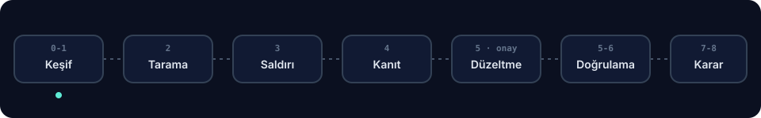

<p align="center">
  
</p>

<p align="center">
  
  
  
  
  
</p>

<p align="center">
  <b>Kendi web projenizi yayına almadan önce saldırgan gözüyle test eden Agent Skill.</b><br>
  Gezer · saldırır · kanıtlar · <i>onayınızla</i> düzeltir · aynı saldırıyla doğrular · regresyon testi yazar · <b>GO / KOŞULLU GO / NO-GO</b> der.
</p>

<p align="center">
  
</p>

---

## ✨ Neden Visual Tester?

| | |
|---|---|
| 🧭 **Her şeyi gezer** | Her sayfa, menü, link, buton, form, API ucu ve admin paneli; rol bazlı (anonim, kullanıcı A/B, admin). Kodda olup arayüzde görünmeyen gizli route'ları da bulur. |
| 🎯 **Kanıt olmadan "açık" demez** | Her bulgu çalışan bir PoC ile doğrulanır: istek/yanıt, ekran görüntüsü veya kod yolu izi. |
| 🛠️ **Kök nedenden düzeltir** | Tek tek yama yerine merkezi middleware, policy, şema doğrulama, parametreli sorgu. |
| 🔁 **Kapandığını kanıtlar** | Aynı saldırıyı tekrar çalıştırır; regresyon testi yazar ve düzeltme geri alınınca testin kırıldığını doğrular. |
| 🗣️ **Sade Türkçe** | Her bulguda "Bu ne demek?": güvenlik uzmanı olmayanlar için tek cümlelik açıklama. |
| 🧱 **Kodla zorlanan sınırlar** | Kapsam dışı, canlı üretim ve bulut metadata hedefleri `scope-guard.mjs` tarafından reddedilir. |

## 🚫 Ne yapmaz

- Başkasının sitesini, izinsiz sistemleri veya **canlı üretimi** test etmez.
- Yük/DoS testi, gerçek hesap kırma, sosyal mühendislik yapmaz; gerçek kullanıcı verisine dokunmaz.
- Onayınız olmadan kod, config, bağımlılık veya veritabanını değiştirmez.
- "Hiç açık yok" demez: her raporda **kalan risk ve test edilemeyenler** bölümü vardır.

## ⚡ Kurulum

<details open>
<summary><b>Claude Code</b></summary>

```bash
# Kullanıcı düzeyi (tüm projeler)
cp -r visual-tester ~/.claude/skills/
# Yalnızca bir proje
cp -r visual-tester <proje>/.claude/skills/
```
</details>

<details>
<summary><b>Codex</b></summary>

```bash
cp -r visual-tester ~/.codex/skills/
```
Skill desteği olmayan sürümlerde `templates/AGENTS.snippet.md` içeriğini projenin `AGENTS.md` dosyasına ekleyin ve `<SKILL_DIR>` yerine klasör yolunu yazın.
</details>

<details>
<summary><b>Gereksinimler</b></summary>

| Araç | Zorunlu | Ne için |
|---|:-:|---|
| Node.js ≥ 18 | ✅ | Tüm `.mjs` scriptleri, kapsam bekçisi |
| curl, bash | ✅ | `.sh` scriptleri (Windows'ta Git Bash veya WSL) |
| Playwright + Chromium | ⭐ | Envanter ve arayüz testleri: `npm i -D playwright && npx playwright install chromium` |
| git | ⭐ | Geri alma dalı, geçmişte sır taraması |
| Docker | ➕ | ZAP, konteynerde DB snapshot |
| semgrep, gitleaks, nuclei, ZAP | ➕ | Yoksa adım raporda "araç yok" olarak geçer |

Eksikleri tek listede görmek için: `bash scripts/preflight.sh`
</details>

## 🚀 Kullanım

Projenizin kökünde ajana yazmanız yeterli:

```text
Bu projenin güvenlik testini yap. Uygulama localhost:3000'de.
Test hesapları: a@test.local, b@test.local, admin@test.local (şifreler env'de).
```

| Mod | Ne zaman | Örnek |
|---|---|---|
| ⚡ `quick` | Yayından hemen önce | "deploy öncesi hızlı bir açık taraması yap" |
| 🧪 `standard` | Varsayılan, tam akış | "admin paneli dahil güvenlik testi yap" |
| 🔬 `deep` | Ödeme/iş mantığı kritikse | "derin pentest, iş mantığı ve fuzzing dahil" |
| 🔁 `retest` | Düzeltmelerden sonra | "düzelttim, tekrar test et" |

Staging için önce sahiplik onayıyla kapsam tanımlanır:

```bash
node scripts/scope-guard.mjs --init --target https://staging.myapp.dev --confirm
```

### 🃏 Onay kartı

Hiçbir değişiklik bu kart olmadan yapılmaz:

```text
1) Denediğim saldırı : Kullanıcı B ile GET /api/orders/17 (A'nın siparişi)
2) Bu ne demek?      : Giriş yapan herkes adres çubuğundaki numarayı değiştirerek başkalarının siparişlerini görebiliyor.
3) Kanıt             : src/routes/orders.ts:42 · 200 + A'nın verisi · güven: Yüksek
4) Önem              : Yüksek · CWE-639 · OWASP A01 / API1
5) Değişiklik        : 3 rotada findById → findFirst({ id, userId }) (merkezi policy)
6) Yan etki / geri al: admin listesi etkilenmez · git revert <sha>
   [Uygula]  [Atla]  [Farklı çöz]  [Riski kabul et]
```

### 📦 Çıktılar (`.visual-tester/`, git'e girmez)

| Dosya | İçerik |
|---|---|
| `report.md` | Karar, yönetici özeti, bulgular, kapsam matrisi, kalan risk |
| `findings.json` | Bulgular ve durum geçmişi (sırlar maskeli) |
| `inventory.json`, `authz-matrix.md` | Gezilen yüzeyler, rol × endpoint matrisi |
| `evidence/<ID>/` | İstek/yanıt, ekran görüntüsü, kod yolu izi, retest |
| `state.json` | Kesilen oturumu kaldığı yerden sürdürmek için |

## 🧰 Scriptler

Hepsi `--help` destekler. Hedefe istek atan her script önce `scope-guard.mjs`'den geçer.

| Script | Görev |
|---|---|
| `preflight.sh` | Araç kontrolü, eksikler tek listede |
| `scope-guard.mjs` | Kapsam kontrolü, staging tanımı, SSRF canary dinleyici |
| `inventory.mjs` | Rol bazlı tarayıcı envanteri, kod route'larıyla karşılaştırma |
| `authz-matrix.mjs` | Rol × endpoint erişim matrisi, IDOR sinyali |
| `tools-run.sh` | semgrep, gitleaks, ZAP baseline, nuclei |
| `headers-check.sh` | Güvenlik başlıkları, CSP, cookie, CORS, TLS |
| `secrets-scan.sh` | Çalışma ağacı + git geçmişi sır taraması (maskeli) |
| `deps-audit.sh` | npm/pnpm/yarn, pip-audit, composer, govulncheck, bundle-audit, dotnet |
| `db-snapshot.sh` / `db-restore.sh` | SQLite/Postgres/MySQL yedek ve geri yükleme (Docker uyumlu) |
| `findings.mjs` | Bulgu kaydı, durum makinesi, içe aktarma, karar, rapor, state |
| `coverage.mjs` | Yüzey × saldırı sınıfı kapsam matrisi |

## 🖥️ Platform uyumluluğu

| Platform | Durum |
|---|---|
| Linux, macOS | ✅ Tam |
| WSL2 | ✅ Tam (ZAP için Docker Desktop WSL entegrasyonu) |
| Windows + Git Bash | ✅ Çalışır: `.sh` scriptleri Git Bash ile; semgrep için WSL/Docker; `timeout` yoksa TLS kontrolü zaman aşımsız |
| PowerShell / cmd (bash'siz) | ⚠️ Yalnızca `.mjs` scriptleri; `.sh` için Git Bash veya WSL gerekir |

## ⚠️ Sınırlar

- Otomatik testler tüm açıkları bulamaz; karmaşık iş mantığı insan incelemesi ister.
- Kapsam, verdiğiniz test hesaplarıyla sınırlıdır.
- Ödeme, e-posta, SMS akışları yalnızca sandbox/sahte sağlayıcıyla test edilir; değilse "test edilmedi" yazılır.
- Sızan sırların rotasyonu sizin işinizdir; skill tespit eder ve adımları söyler.

---

<p align="center">
  <sub>MIT lisanslıdır · bkz. <a href="LICENSE">LICENSE</a></sub><br><br>
  <a href="https://muhammedkoca.com.tr">
    
  </a>
</p>
